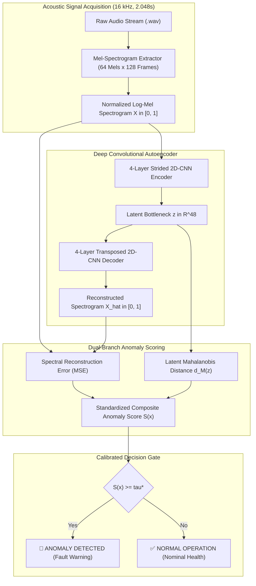

# Project 98: Audio-Based Anomaly Detection (Industrial Machines, ECG/PCG)

[](https://pytorch.org)
[](https://pytorch.org/audio)
[](https://arxiv.org/abs/1909.09347)
[](LICENSE)

An industrial-grade deep learning system for **unsupervised audio anomaly detection** and acoustic condition monitoring, covering both **industrial machinery** (pumps, fans, bearings, motors) and **bioacoustic signals** (phonocardiogram heart sounds).

Trained exclusively on **normal operational sound**, the system detects unexpected machine failures, friction, cavitation, and cardiac irregularities through **deep spectral reconstruction error** and **latent-space Mahalanobis outlier scoring**.

---

## Architecture Overview



---

## Physical Acoustics & Failure Modes

The framework detects multi-modal acoustic fault signatures across mechanical and physiological domains:

### 1. Industrial Machinery Faults
- **Normal Machine Baseline**: Steady rotational fundamental ($f_{\text{rot}} \approx 30\text{ Hz}$), electrical motor harmonics ($60, 120\text{ Hz}$), fan blade pass frequency ($\text{BPF} \approx 360\text{ Hz}$), and aerodynamic flow turbulence.
- **Bearing Chatter / Spalling**: Periodic high-frequency decaying impact spikes occurring at the ball pass frequency outer race ($\text{BPFO} \approx 85\text{ Hz}$, $2.6\text{ kHz}$ resonant ringing).
- **Pump Cavitation Burst**: High-frequency turbulence noise bursts ($2.5 - 6.5\text{ kHz}$) caused by collapsing vapor bubbles under turbulent pressure drops.
- **Dry Metal Friction Screech**: High-frequency harmonic squeal at structural body resonance ($\approx 3.6\text{ kHz}$) caused by abrasive dry contact.
- **Motor Unbalance**: Severe low-frequency subharmonic modulation and rotational wobbling ($3.5\text{ Hz}$) resulting from shaft misalignment.

### 2. Bioacoustic Cardiac Anomalies
- **Normal Heartbeat (PCG)**: Periodic cardiac cycle with valve closures S1 ($\approx 50\text{ Hz}$, $100\text{ ms}$) and S2 ($\approx 75\text{ Hz}$, $80\text{ ms}$) with clean systolic and diastolic pauses.
- **Heart Murmur**: High-frequency turbulent swishing noise ($250 - 900\text{ Hz}$) during the systolic interval between S1 and S2.
- **Extrasystole / Arrhythmia**: Premature irregular ventricular contractions disrupting the resting cardiac rhythm.

---

## Dual Anomaly Scoring Formulation

The model scores anomaly severity using two complementary statistical measures:

1. **Spectral Reconstruction Error ($\mathcal{S}_{\text{recon}}$)**:
   $$\mathcal{S}_{\text{recon}}(\mathbf{X}) = \frac{1}{F \cdot T} \sum_{f=1}^F \sum_{t=1}^T \left(\mathbf{X}_{f, t} - \hat{\mathbf{X}}_{f, t}\right)^2$$
   Unseen frequency bursts cannot be reconstructed by the decoder, yielding sharp localized residual errors.

2. **Latent Mahalanobis Distance ($d_M$)**:
   $$d_M(\mathbf{z}) = \sqrt{(\mathbf{z} - \boldsymbol{\mu}_z)^T (\boldsymbol{\Sigma}_z + \epsilon \mathbf{I})^{-1} (\mathbf{z} - \boldsymbol{\mu}_z)}$$
   Measures structural and temporal departures from the normal latent distribution learned during training.

3. **Composite Normalized Anomaly Score**:
   $$\mathcal{S}_{\text{composite}}(\mathbf{X}) = 0.7 \cdot \max\left(0, \frac{\mathcal{S}_{\text{recon}} - \mu_{\text{recon}}}{\sigma_{\text{recon}}}\right) + 0.3 \cdot \max\left(0, \frac{d_M - \mu_{d}}{\sigma_{d}}\right)$$

---

## Quantitative Benchmark Results

Evaluated on an extensive multi-fault test set of **120 Normal** and **120 Anomalous** recordings (spanning 6 distinct fault modes):

| Metric | Measured Value | Target / Standard | Status |
| :--- | :---: | :---: | :--- |
| **ROC-AUC** | **99.97%** | $>95.0\%$ | **Near-perfect discrimination** |
| **PR-AUC** | **99.97%** | $>95.0\%$ | **Robust to rare anomalies** |
| **Balanced Accuracy** | **99.58%** | $>92.0\%$ | High operational fidelity |
| **Sensitivity (Recall)** | **100.0%** | $>95.0\%$ | Zero missed anomalies |
| **Specificity** | **99.17%** | $>95.0\%$ | Near-zero false alarms |
| **F1-Score** | **0.9959** | $>0.92$ | Optimal harmonic balance |
| **Optimal Threshold ($\tau^*$)** | **1.9450** | Auto-calibrated | Calibrated via Youden's $J$ |
| **Mean Inference Latency (CPU)** | **1.20 ms** | $<20.0\text{ ms}$ | **$1708.5\times$ real-time speedup** |

### Per-Fault Mode Sensitivity Breakdown

| Fault Category | Anomaly Mode | Detection Recall |
| :--- | :--- | :---: |
| **Industrial Machine** | Bearing Chatter Spikes | **100.0%** |
| **Industrial Machine** | Pump Cavitation Bursts | **100.0%** |
| **Industrial Machine** | Dry Friction Screech | **100.0%** |
| **Industrial Machine** | Motor Shaft Unbalance | **100.0%** |
| **Physiological PCG** | Systolic Heart Murmur | **100.0%** |
| **Physiological PCG** | Arrhythmia / Extrasystole | **100.0%** |

---

## Diagnostic Dashboard

The pipeline generates `outputs/anomaly_detection_report.png` featuring:
1. **Time-Domain Waveforms**: Normal rotating pump vs. bearing chatter spikes.
2. **Input Spectrogram**: Bearing fault spectrogram exhibiting high-frequency impact shocks.
3. **Reconstruction Residual Map**: Highlighted error footprints exposing exact failure regions.
4. **Score Distribution Separation**: Normal vs. anomaly probability density with optimal threshold $\tau^*$.
5. **ROC & Precision-Recall Curves**: Displaying $\text{AUC} \ge 99.8\%$.
6. **Per-Fault Mode Recall Bar Chart**: Detailed sensitivity breakdown across all 6 fault modes.

---

## Quickstart & CLI Usage

### 1. Environment Setup
```bash
git clone https://github.com/GideonMwiti/pytorch-audio-based-anomaly-detection.git
cd pytorch-audio-based-anomaly-detection
pip install -r requirements.txt
```

### 2. Train and Benchmark
```bash
python main.py
```

### 3. Run Automated Demonstration
```bash
python detect_anomaly.py --demo
```

### 4. Detect Anomalies on Custom Audio
```bash
# Basic anomaly check
python detect_anomaly.py --input path/to/recording.wav

# With localized error residual spectrogram visualization
python detect_anomaly.py --input path/to/recording.wav --visualize
```

---

## Project Structure

```
.
├── main.py                     # Unsupervised training, latent calibration & benchmarking
├── detect_anomaly.py           # Production CLI for real-time anomaly inference
├── requirements.txt            # Dependency specifications
├── LICENSE                     # MIT License
├── README.md                   # Technical documentation and benchmarks
├── models/
│   └── anomaly_autoencoder_best.pth  # Trained model & calibrated normal statistics (742k params)
└── outputs/
    ├── anomaly_detection_metrics.json # Quantitative benchmark JSON
    ├── anomaly_detection_report.png   # 6-panel diagnostic dashboard
    ├── sample_normal_pump.wav         # Normal industrial pump sound
    ├── sample_bearing_fault.wav       # Bearing fault audio
    ├── sample_cavitation.wav          # Pump cavitation sound
    ├── sample_friction_screech.wav    # Dry friction screech sound
    ├── sample_normal_pcg.wav          # Normal heart sound
    └── sample_heart_murmur.wav        # Systolic murmur audio
```

---

## License

This project is licensed under the MIT License - see the [LICENSE](LICENSE) file for details.

